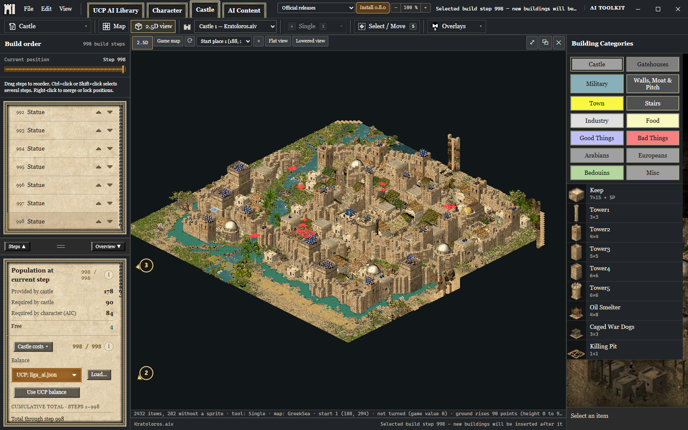
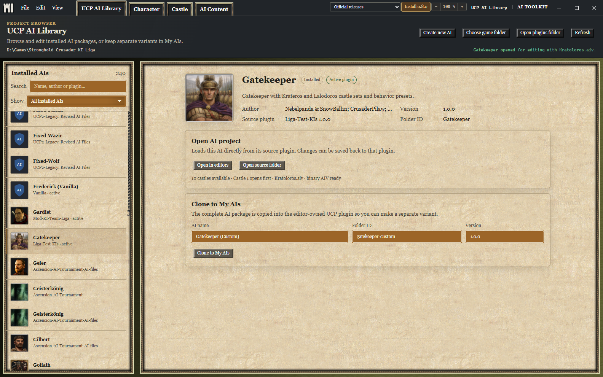
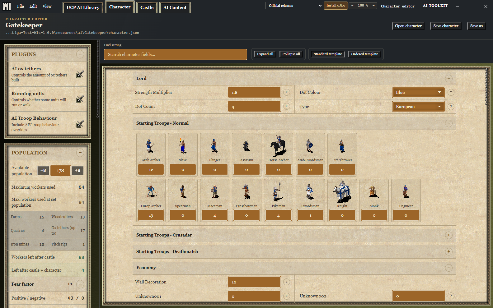
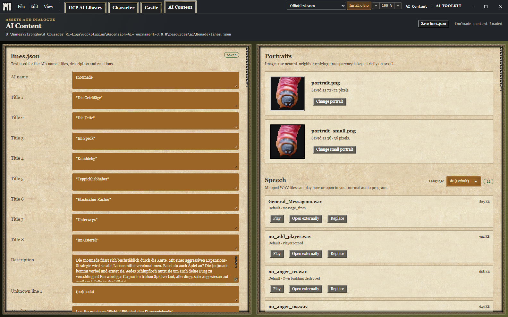

# AI Toolkit

Edit Stronghold Crusader AI behavior, design castles, and manage UCP AI projects
in one desktop app.

[Windows preview downloads](https://github.com/Krarilotus/AI-Toolkit/releases) ·
[Official releases](https://github.com/Schlossgespensty/AI-Toolkit/releases) ·
[Report a bug](https://github.com/Schlossgespensty/AI-Toolkit/issues/new)



## What you can do

| Workspace | Tools |
| --- | --- |
| UCP AI Library | Browse installed AIs, create or clone projects, and assign castle slots. |
| Character | Tune the economy, recruitment and starting troops. Check population, storage and fear factor. |
| Castle | Edit in 2D and 2.5D, reorder build steps, copy building groups, and inspect costs and terrain conflicts. Path and fire overlays provide planning estimates. |
| AI Content | Edit dialogue and portraits, preview or replace speech, and open mapped videos. |

Rotate with **X/C**, toggle flat view with **Space**, or lower structures with
**V**. The app has Default and UCP themes and nine interface languages.
[Controls](docs/castle-editing-controls.md) · [Analysis limits](docs/castle-analysis.md)

## Supported files

- Classic Crusader `.aiv` castles and UCP JSON files.
- Experimental DE `.aivjson` and `.aijson` editing. DE graphics and in-game
  compatibility remain unverified. See [DE support](docs/definitive-edition-integration.md).
- [Up to 30 troop spots](docs/expanded-troop-spots.md) for supported types.
  Extra spots require DE with SHCDE-Fixes and its per-AI setting. Classic export
  remains limited to ten.

## Get started

1. On 64-bit Windows 10 or newer, get the setup EXE or portable ZIP from
   **Windows preview downloads** above for this branch's features.
2. Run the installer, or extract the entire ZIP and open `AI Toolkit.exe`.
   The app downloads Microsoft WebView2 if it is missing.
3. In UCP AI Library, choose your classic Crusader game folder and open an AI.
   Use **Clone to My AIs** to make a separate variant before editing.

Character and castle file editing work without a game installed. The Library
needs UCP; maps and game artwork need a local classic Crusader installation.

<details>
<summary>More screenshots</summary>

### UCP AI Library



### Character



### AI Content



Screenshots use the UCP theme. [Capture details and credits](docs/screenshots/README.md).

</details>

## Contribute

Send bug reports and pull requests, or help with translations and themes. For
bugs, include your build, steps to reproduce, and an example file when possible.

To run from source on Windows, install Node.js 22.12 or newer, stable Rust and
the Microsoft C++ build tools, then run:

```powershell
npm ci
npm start
```

Before a pull request, run `npm run check` and `npm run check:locales`. For Rust
changes, also run `cargo test --locked --manifest-path src-tauri/Cargo.toml`.
See [native setup and packaging](docs/native-packaging.md) and the
[theme guide](docs/editor-themes.md).

No project license has been selected yet. See [bundled asset status](ASSETS.md).
